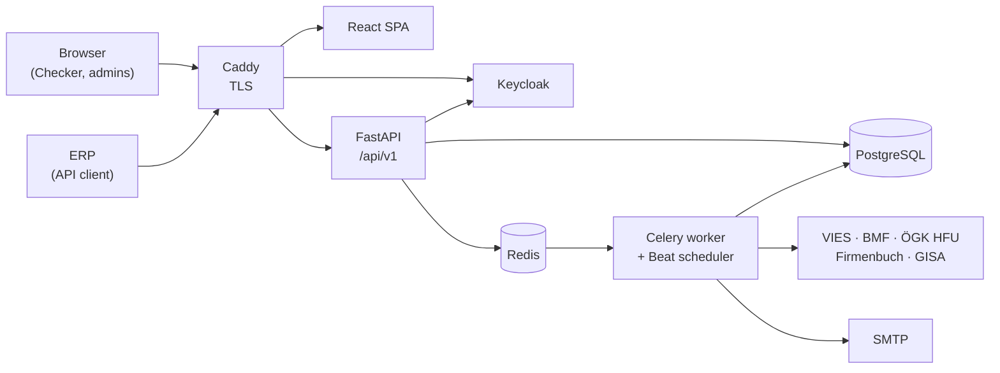

# BizPartnerCheck

Due diligence checks for construction companies.

## Tech stack and architecture

> Backlog item **E01-01 – Choose tech stack and architecture**. Status: **proposed**, accepted when this PR is merged.
> Diagrams and details: [docs/architecture.md](docs/architecture.md). IDs such as CON-… and OI-… refer to the SRS v0.1.

### Decision

| Layer | Choice | Why |
|---|---|---|
| **Backend** | **Python 3.13 + FastAPI**, SQLAlchemy 2 + Alembic, Pydantic v2, httpx | The whole team already works in Python (PyCharm). FastAPI generates the OpenAPI 3.1 document we must publish. Async `httpx` calls the 5 sources in parallel with timeouts and retries (≤ 15 s per run). |
| **Background jobs** | **Celery + Redis**, Celery Beat | A check run is started via `POST /api/v1/checks` → `202` and runs in a worker. Celery Beat runs the BMF update every 30 min, the daily list import and the retention job. |
| **Frontend** | **React + TypeScript** (Vite), react-i18next, oidc-client-ts | Single-page app that uses the same `/api/v1` as the ERP, so web and API always give the same result. German/English texts in language files. Biggest ecosystem and lots of learning material. |
| **Database** | **PostgreSQL 17** | Relational data with real constraints (organizations, users, runs, results), JSONB for the raw source answers, transactions so a run is stored completely or marked incomplete, triggers that block changes to stored runs, fast filters for the history. |
| **Identity** | **Keycloak** (self-hosted, open source) | We must not build authentication ourselves (CON-07). Gives OIDC sign-in, password policy and lockout, reset and invitation e-mails, and OAuth 2.0 client credentials for API tokens. Runs in Docker, no cloud dependency. *To confirm with the customer (OI-10).* |
| **PDF reports** | **WeasyPrint** (HTML/CSS templates → PDF) | Same Jinja2 templates in German and English. |
| **Deployment** | **Docker Compose** on one Linux VM, **Caddy** as reverse proxy | Install with one command, no proprietary cloud. Caddy handles TLS automatically. |
| **CI / quality** | **GitHub Actions**: ruff, pytest + coverage, ESLint + Vitest, Docker build, dependency audit | Every PR is built and tested, ≥ 70 % coverage for rules and adapters, library check. |

Tooling: `uv` for Python dependencies, `ruff` for lint + format, `npm` for the frontend, Mailpit as a fake mail server in development.

### Architecture in one picture

A **modular monolith**: one backend code base that runs as an API process and a worker process,
plus the frontend, PostgreSQL, Redis and Keycloak, all in one `docker-compose.yml`.

Main rules (details in [docs/architecture.md](docs/architecture.md)):

1. **One adapter per data source** behind a common interface; the check rules never contain source-specific code.
2. **The rule engine is pure Python** (no HTTP, no database), so it is easy to unit-test.
3. **A source that does not answer gives `ERROR`, never `PASSED`**.
4. **Every query is filtered by organization** taken from the token.
5. **Stored runs are append-only** and get a SHA-256 hash.
6. **No secrets in the code**: everything comes from environment variables / `.env`.

### Why not …

| Alternative | Why we did not pick it |
|---|---|
| Microservices | Too much overhead for our size; ~20 checks/minute at peak (ASM-05) fit easily in one service. |
| Django + DRF | Great admin and auth, but we must use an external identity solution anyway; FastAPI's async calls and automatic OpenAPI fit our source checks better. |
| Server-rendered pages (Jinja2 + HTMX) | Less JavaScript, but the web app would need a second auth path (sessions) next to the API tokens and could drift from the API. |
| Java / Spring Boot, .NET | Solid, but the team works in Python. |
| MySQL / MongoDB | PostgreSQL is better for JSONB + strict constraints + triggers; MongoDB has no relational integrity for evidence data. |
| Auth0 / other hosted identity | Free tiers are limited and add a cloud dependency. Ory is a lighter option if Keycloak turns out too heavy. |
