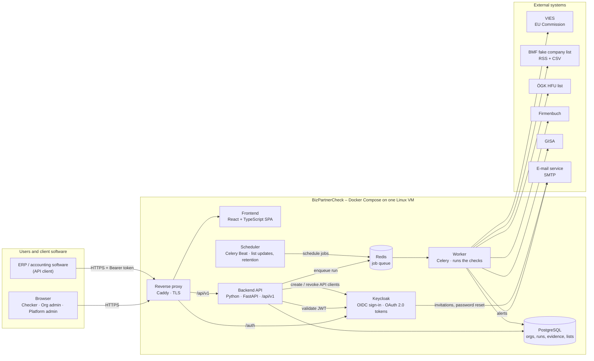
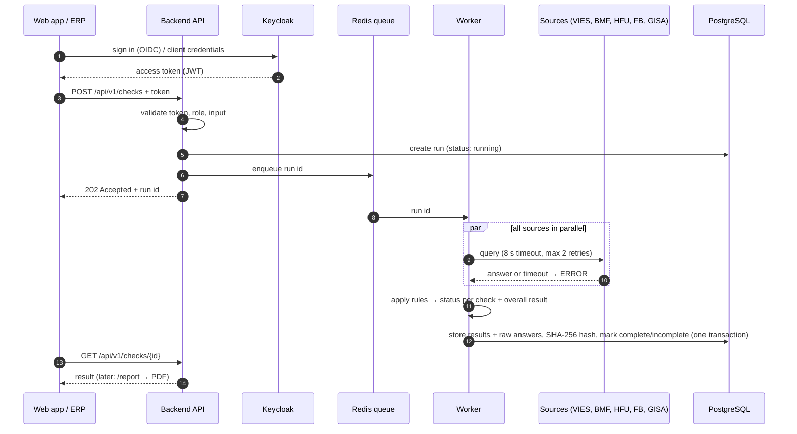

# BizPartnerCheck – Architecture

Backlog item **E01-01 – Choose tech stack and architecture**.
The reasons for each technology are in the [README](../README.md#tech-stack-and-architecture).
IDs such as CON-… and OI-… refer to the SRS v0.1.

## 1. Style: modular monolith

BizPartnerCheck is **one backend codebase** that runs as two processes (API and worker),
plus a single-page frontend, a database and an identity server, all started with Docker Compose.

We do not use microservices: the load is small (max. 10,000 checks per day ≈ 20 per minute, ASM-05),
we are a small team and we need **one-command installation**.
Instead, the backend is split into clear modules with fixed boundaries (see section 3),
so that a source or a rule can change without touching the rest.

## 2. Container diagram



| Container | Technology | Responsibility |
|---|---|---|
| Reverse proxy | Caddy | TLS termination, routes `/`, `/api`, `/auth` |
| Frontend | React + TypeScript (Vite), served as static files | All screens of the web app, DE/EN |
| Backend API | Python, FastAPI | REST API `/api/v1` + OpenAPI 3.1, role & organization checks, history, PDF reports |
| Worker | Celery (same code base as the API) | Executes check runs: calls the sources, applies the rules, stores evidence |
| Scheduler | Celery Beat | BMF RSS every 30 min, full CSV daily, retention job |
| Queue | Redis | Hands runs from API to worker; POST returns 202 immediately |
| Database | PostgreSQL | All business data; raw source answers as JSONB |
| Identity | Keycloak | Sign-in, password policy, lockout, reset, invitations, OAuth 2.0 client credentials for API tokens |

The web app is a normal client of the same `/api/v1` as the ERP. This guarantees that web and API
give identical results.

## 3. Backend modules

```mermaid
flowchart TB
    subgraph api_layer["api – HTTP layer (FastAPI routers)"]
        r_checks["checks"]
        r_history["history / reports"]
        r_admin["tokens · users · organizations"]
    end

    subgraph auth_mod["auth"]
        jwt["JWT validation<br/>roles + org from token"]
        kc_admin["Keycloak admin client"]
    end

    subgraph services["services – use cases"]
        s_run["RunService<br/>start, identify partner"]
        s_report["ReportService<br/>PDF (WeasyPrint)"]
        s_admin["AdminService"]
    end

    subgraph engine["engine – pure Python, no I/O"]
        rules["Check rules<br/>VAT · fake company · HFU · register · licence"]
        overall["Overall result<br/>GREEN / YELLOW / RED"]
        risk["Risk rules<br/>person-based · financial"]
    end

    subgraph sources["sources – one adapter per source"]
        iface["SourceAdapter interface<br/>timeout 8 s · 2 retries · 30 s max"]
        a_vies["VIES"]
        a_bmf["BMF"]
        a_hfu["HFU"]
        a_fb["Firmenbuch"]
        a_gisa["GISA"]
    end

    subgraph persistence["db – SQLAlchemy + Alembic"]
        repo["Repositories<br/>always filtered by organization"]
        evidence["Evidence store<br/>append-only + SHA-256"]
    end

    jobs["jobs – Celery tasks<br/>run_check · update_lists · retention"]

    api_layer --> auth_mod
    api_layer --> services
    services --> repo
    services --> evidence
    jobs --> services
    jobs --> sources
    jobs --> engine
    iface --- a_vies & a_bmf & a_hfu & a_fb & a_gisa
    engine -.-|"only data objects,<br/>no source-specific code"| sources
```



Module rules:

- **`engine`** contains only rules and is pure Python (no HTTP, no DB). It is easy to test and is where most
  of the 70 % coverage target applies. Thresholds and texts come from configuration.
- **`sources`**: every external source has its own adapter behind one common interface. An adapter returns a
  normalised result plus the raw answer. A timeout or error gives `ERROR` and never `PASSED`.
- **`db`**: every query is filtered by `organization_id` from the token.
- **`auth`**: we never store passwords; users and API tokens live in Keycloak (CON-07).

## 4. Flow of one check run



## 5. Cross-cutting decisions

| Topic | Decision |
|---|---|
| Multi-tenancy | One database, `organization_id` on every business table; enforced in the repository layer (PostgreSQL row-level security as a second line is optional) |
| Evidence cannot change | Runs/results are append-only: a DB trigger blocks `UPDATE`/`DELETE` on completed runs; SHA-256 over a canonical JSON of the run is stored and printed on the report; notes are a separate table |
| Crash safety | Results are written in one transaction; a startup job marks runs left in `running` as incomplete |
| Configuration & secrets | Only environment variables / `.env` (never committed); `.env.example` in the repo |
| Languages | Frontend texts in `react-i18next` JSON files, backend texts (e-mails, PDF, explanations) in gettext/JSON files; German default |
| Logging | Structured JSON logs with a correlation ID per run; no secrets or dates of birth; `/health` endpoint |
| API contract | OpenAPI 3.1 generated by FastAPI, published at `/api/v1/openapi.json`; versioned under `/api/v1` |
| Testing | `pytest` + coverage for backend, Vitest for frontend, source stubs that answer after 2 s for staging/load tests |

## 6. Planned repository layout

```text
BizPartnerCheck/
├── backend/            # Python package (FastAPI app, worker, engine, sources)
│   ├── app/
│   │   ├── api/        # routers
│   │   ├── auth/
│   │   ├── services/
│   │   ├── engine/     # rules – pure Python
│   │   ├── sources/    # one adapter per source
│   │   ├── db/         # models, repositories, Alembic migrations
│   │   ├── jobs/       # Celery tasks
│   │   └── reports/    # PDF templates
│   ├── tests/
│   └── pyproject.toml
├── frontend/           # React + TypeScript (Vite)
├── infra/              # docker-compose.yml, Caddyfile, Keycloak realm export
├── docs/               # this file, later: SDD, user guide, operations guide
└── .github/workflows/  # CI
```

## 7. Open points that may change this document

- **OI-10** – Keycloak (self-hosted) vs. a hosted identity service: our proposal is Keycloak
- **OI-05** – hosting (VM or cloud): no impact on the stack, Docker Compose runs on both.
- **OI-01 / ASM-01** – if the HFU service has no live query, the HFU list becomes a scheduled import job like the BMF list.
