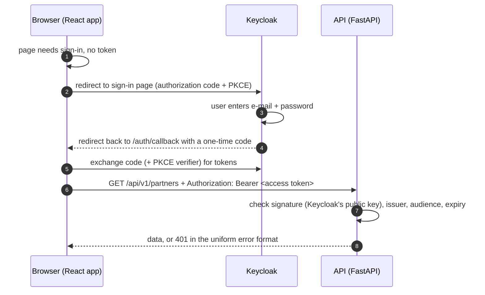

# Authentication (sign in, sign out, password reset)

Story S2.1 (SCRUM-27). State: November 2026. Second factor, roles and the security log: see
[security-log.md](security-log.md) (S2.6).

## Context

Only employees of customer companies may use BizPartnerCheck (FR-37, UR-25). They sign in with e-mail and
password, can reset a forgotten password (FR-38), and sessions must end after inactivity. Passwords must be
stored securely (NFR-07, NFR-08), and the architecture says we never store passwords ourselves (CON-07).

## Decision

**Keycloak** (OpenID Connect) handles sign-in, passwords, password reset, sessions and brute-force protection.
Our code never sees a password.

### Pieces

| Where | What |
|---|---|
| `infra/docker-compose.yml` | `keycloak` (port 8080) and `mailpit` (test e-mails, port 8025) |
| `infra/keycloak/import/bizpartnercheck-realm.json` | Realm `bizpartnercheck`: clients, password policy, brute force, sessions, e-mail, demo users, second factor for admins and events (S2.6). Imported when a new Keycloak container starts |
| `infra/keycloak/themes/bizpartnercheck/` | BizPartnerCheck look of Keycloak's sign-in pages (see "Look of the sign-in pages") |
| `backend/app/auth.py` | Token check for every `/api/v1` request (`get_current_user`), `GET /api/v1/me` |
| `frontend/src/auth/` | `oidc.ts` (oidc-client-ts settings), `RequireAuth.tsx` (protected pages), `use-idle-sign-out.ts` |
| `frontend/src/api/client.ts` | Sends the access token with every API call; renews it once on `401`, otherwise back to sign-in |

### Keycloak settings (realm `bizpartnercheck`)

| Setting | Value | Why |
|---|---|---|
| Client `bizpartnercheck-web` | public client, authorization code flow, PKCE `S256` required, no password grant | Recommended flow for browser apps; no client secret in the browser |
| Audience mapper | adds `bizpartnercheck-api` to access tokens | The API accepts only tokens meant for it |
| Sign-in | e-mail as user name; self-registration off | Companies register through our own form later (S2.2) |
| Password policy | at least 12 characters, not the e-mail, not one of the last 3 | NFR-08 |
| Brute force | after **5** failed sign-ins the account is locked for 5 min (up to 15 min) | T2.1.5 |
| Access token | 5 minutes; renewed in the background with the refresh token | Short-lived tokens limit the damage of a leaked token |
| Session idle / max | 30 minutes / 10 hours | T2.1.5 |
| Password reset link | valid 30 minutes | T2.1.4 |
| Languages | English and German (follows the browser) | NFR-17 |
| E-mail | SMTP `mailpit:1025` (local only) | Reset mails are visible at http://localhost:8025 |
| Second factor | one-time code from an authenticator app: required for role `org-admin`, optional for others | NFR-11, see security-log.md |
| Events | sign-in and admin events stored 30 days, copied into our security log | NFR-08, see security-log.md |
| Client `bizpartnercheck-api` | confidential, service account only (reads events and users) | Used by the API for the security log |

### Look of the sign-in pages

The sign-in, "forgot password" and "new password" pages are Keycloak's own pages (that is what keeps
passwords out of our code). The theme `bizpartnercheck` only adds CSS (and one tiny script) on top of Keycloak's default theme
(`keycloak.v2`, PatternFly 5): our logo, the Geist font, the neutral shadcn colours from
`frontend/src/index.css`, the same radius and light/dark mode following the operating system.

- Files: `theme.properties` (parent theme, list of CSS and script files), `resources/css/bizpartnercheck.css`
  and `resources/js/otp-input.js` (accepts one-time codes typed as "123 456", see security-log.md);
  font files (Geist, SIL Open Font License, see `resources/fonts/OFL-LICENSE.txt`) and the logo are copies.
- Keycloak runs in development mode, so CSS changes show after reloading the page. Changing
  `theme.properties` needs `docker compose -f infra/docker-compose.yml restart keycloak`.
- When the app colours change in `index.css`, update the `--bpc-…` variables at the top of the CSS file.
- Not themed (yet): the "Account and Password" console and the e-mails.

### Backend

- Every route under `/api/v1` depends on `get_current_user` (`app/main.py`), so new routes are protected
  automatically. `/health` stays public.
- Roles: the token's realm roles (`realm_access.roles`) are in `CurrentUser.roles`. Routes for admins use the
  dependency `OrgAdmin` (otherwise `403 forbidden`). `GET /api/v1/me` returns the roles too.
- The token is checked locally with PyJWT: RS256 signature with the key from Keycloak's JWKS endpoint (cached
  10 minutes, reloaded when Keycloak rotates its key), `iss`, `aud`, `exp` (30 s clock tolerance), required
  claims and `typ: Bearer` (ID and refresh tokens are refused).
- Errors: `401` with `not_authenticated`, `invalid_token` or `token_expired` and the header
  `WWW-Authenticate: Bearer`; `503 auth_unavailable` when Keycloak's keys cannot be loaded.
- Configuration (all optional for local development): `OIDC_ISSUER`, `OIDC_AUDIENCE`, `OIDC_JWKS_URL`
  (see `.env.example`).

### Frontend

- `oidc-client-ts` + `react-oidc-context`. Every page except `/sign-in` is wrapped in `RequireAuth`: without a
  valid session the user is sent to Keycloak and comes back to the page they wanted (only paths inside the app
  are accepted as return target).
- Tokens are kept in `sessionStorage` (this tab only, gone when it is closed).
- **Inactivity:** the access token is renewed in the background while the tab is open, so Keycloak alone would
  never see the user as inactive. The app therefore signs the user out (also in Keycloak) after 30 minutes
  without clicks, key presses or scrolling and shows "You were signed out after 30 minutes without activity".
- **Several tabs:** all tabs share one Keycloak session. Tabs share their last activity (`localStorage`), so the
  idle sign-out happens only when every tab is idle, and a sign-out in one tab signs out the other tabs at once
  (`BroadcastChannel`).
- **No redirect loops:** if the API refuses a token that Keycloak has just issued, the app shows "The server does
  not accept your sign-in" instead of sending the user to Keycloak again and again (see Troubleshooting).
- The user menu (bottom left) shows the signed-in user and offers **Account and Password** (Keycloak's
  account page, where the password is changed) and **Sign Out**.
- Configuration (optional): `VITE_OIDC_AUTHORITY`, `VITE_OIDC_CLIENT_ID`, `VITE_IDLE_TIMEOUT_MINUTES`
  (e.g. in `frontend/.env.local`).

### Calling the API by hand

The client does not allow the password grant, so get a token from the browser: sign in, open the developer
tools → Application → Session Storage → `oidc.user:…` → copy `access_token`. In http://localhost:8000/docs,
click **Authorize** and paste it. The token is valid for 5 minutes.

## Troubleshooting

| What you see | Likely cause | Fix |
|---|---|---|
| Sign-in page does not open, "Sign-In Not Available" | Keycloak not started or still starting (about 30 s) | `docker compose -f infra/docker-compose.yml up -d`, wait, try again |
| "The server does not accept your sign-in" right after signing in | API settings do not match Keycloak (`OIDC_ISSUER`, `OIDC_AUDIENCE`, e.g. `127.0.0.1` vs `localhost`) or the Docker clock is off (common after the laptop slept) | Check `.env`; restart Docker Desktop to fix the clock |
| API answers `503 auth_unavailable` | The API cannot load Keycloak's keys | Is Keycloak running? Is `OIDC_JWKS_URL` right? |
| "Invalid username or password" with the right password | Account locked after 5 failed attempts | Wait 5 minutes, or unlock the user in the admin console (Users → user → "Temporarily locked") |
| Password reset mail missing | Mail goes to Mailpit, not to a real inbox | Open http://localhost:8025 |
| "Account and Password" shows "Something went wrong" | The user lacks the default roles (`view-profile`, `manage-account`); users from the realm file get them only through `realmRoles: ["default-roles-bizpartnercheck"]` | Admin console → Users → user → Role mapping → Assign role `default-roles-bizpartnercheck`, or recreate Keycloak |

## Why / Alternatives

- **Own login with password hashes in our database:** more code, more risk (hashing, reset tokens, lockout,
  sessions), and against the architecture decision to store no passwords.
- **keycloak-js** (Keycloak's own browser adapter): works, but `oidc-client-ts` is provider-neutral, typed and
  widely used; switching the identity provider later (open point OI-10) needs no frontend change.
- **Tokens only in memory:** safer against stolen storage, but every page reload would need a redirect to
  Keycloak. `sessionStorage` is a common compromise; the short token lifetime limits the risk.

## Not part of S2.1

- Organisation in the token and data separation → S2.3
- Roles and inviting users → S2.4
- Second factor (MFA) for admins → done in S2.6, see [security-log.md](security-log.md)
- Production setup (persistent Keycloak database, HTTPS host names, real SMTP, no demo user, strong admin
  password) → S1.3 / test deployment
