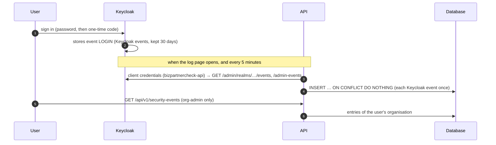

# Account security and security log

Story S2.6 (SCRUM-51): T2.6.1 MFA for admins, T2.6.2 security event log, T2.6.3 security log page.
State: November 2026. Builds on [authentication.md](authentication.md) (S2.1).

## Context

- Admins must confirm their sign-in with a second factor (authenticator app); other users may (NFR-11).
- Sign-ins, failed sign-ins, user and role changes, API token creation and revocation, and exports are logged
  with time and actor (NFR-08).
- Organisation admins see the log of their own organisation, filterable by event and date (UR-29).

## Decision

**Second factor:** Keycloak's own one-time codes (TOTP, RFC 6238). Every authenticator app works (Microsoft
Authenticator, Google Authenticator, 1Password, …). The sign-in flow asks for the code after the password:
always for users with the realm role `org-admin`, for everyone else only if they have set up an app.

**Security log:** one append-only table `security_events` in our database. Two sources write into it:

| Source | Events | How they get in |
|---|---|---|
| Keycloak | sign-in, failed sign-in, sign-out, account locked, password changed / reset requested, authenticator set up / removed, users created / changed / deleted, roles given / taken | The API copies Keycloak's events with a read-only service account (when the log page is opened, and every 5 minutes) |
| The app | API token created / revoked (S5.x), data exported | `record_event()` in the same transaction as the action |



### Pieces

| Where | What |
|---|---|
| `infra/keycloak/import/bizpartnercheck-realm.json` | Role `org-admin`, demo admin, sign-in flow "browser with admin 2FA", OTP policy, events, client `bizpartnercheck-api` (service account) |
| `backend/app/security/events.py` | Event types, `record_event()` for events of the app |
| `backend/app/security/keycloak.py` | Reads Keycloak's events (admin REST API), turns them into log entries, copies new ones |
| `backend/app/security/background.py` | Copies every 5 minutes while the API runs |
| `backend/app/security/router.py` | `GET /api/v1/security-events`, `GET /api/v1/security-events/export` |
| `backend/app/auth.py` | Roles from the token (`realm_access.roles`), `require_role`, `OrgAdmin` |
| `backend/app/db/migrations/versions/f90a185a4670_…` | Table, indexes and the append-only trigger |
| `frontend/src/pages/SecurityLogPage.tsx` | Page **Organization → Security Log** (only shown to org admins) |
| `frontend/src/auth/roles.ts` | Roles from the access token, to show or hide menu items |

## Second factor (T2.6.1)

Sign-in flow `browser with admin 2FA` (Keycloak admin console → Authentication):

```
Cookie                                   ALTERNATIVE   (already signed in)
Identity provider redirector             ALTERNATIVE
admin 2FA forms                          ALTERNATIVE
├─ Username Password Form                REQUIRED
├─ second factor for org admins          CONDITIONAL
│  ├─ Condition - user role (org-admin)  REQUIRED
│  └─ OTP Form                           REQUIRED      → set-up page if no app yet
└─ second factor if set up               CONDITIONAL
   ├─ Condition - user role (NOT org-admin)
   ├─ Condition - user configured        REQUIRED
   └─ OTP Form                           REQUIRED
```

- **Admins** without an app see the set-up page (QR code) right after the password and cannot continue without
  it. Afterwards every sign-in asks for the 6-digit code.
- **Other users** turn it on in **Account and Password → Account security → Signing in → Set up authenticator
  application** (the Security Log page links there too). From then on they are asked for the code as well.
- **Lost phone:** a Keycloak admin deletes the user's "OTP" credential (admin console → Users → user →
  Credentials). Admins are asked to set up a new app at the next sign-in. This is logged as "Sign-in method …
  removed".
- Codes: 6 digits, 30 seconds, SHA-1 (what all apps support), one step of clock tolerance; each code works once.
  They may be typed as `123456` or `123 456` (as many apps show them): Keycloak only accepts digits, so
  `resources/js/otp-input.js` in our theme removes spaces before the form is sent.
- Wrong codes count as failed sign-ins for the brute-force lock (5 tries, see authentication.md).

Who is an admin: the realm role `org-admin` (until S2.4 assigned in the Keycloak admin console → Users → user →
Role mapping). The API reads it from the token; the app shows admin-only pages based on the same claim, but the
API checks every request itself.

## Security log (T2.6.2)

### What is logged

| Event type | Shown as | From |
|---|---|---|
| `SIGN_IN` | Signed in with password (and one-time code) | Keycloak `LOGIN` |
| `SIGN_IN_FAILED` | Sign-in failed: wrong password or one-time code / unknown e-mail address / … | `LOGIN_ERROR` |
| `SIGN_OUT` | Signed out; "… signed out of all sessions" by an admin | `LOGOUT`; admin action `users/{id}/logout` |
| `ACCOUNT_LOCKED` | Account locked after too many failed sign-ins | `USER_DISABLED_BY_*_LOCKOUT` |
| `PASSWORD_CHANGED` | Password changed; "Password of … set" by an admin | `UPDATE_CREDENTIAL` (password); admin `reset-password` |
| `PASSWORD_RESET_REQUESTED` | Password reset e-mail requested | `SEND_RESET_PASSWORD` |
| `MFA_ENABLED` / `MFA_REMOVED` | Authenticator app set up / removed | `UPDATE_CREDENTIAL` / `REMOVE_CREDENTIAL` (otp); admin deletes a credential |
| `USER_CREATED` / `USER_UPDATED` / `USER_DELETED` | User … created / changed (account disabled) / deleted | Admin events on `users/{id}` |
| `ROLE_ASSIGNED` / `ROLE_REMOVED` | Role org-admin given to / taken from … | Admin events `REALM_ROLE_MAPPING`, `CLIENT_ROLE_MAPPING` |
| `API_TOKEN_CREATED` / `API_TOKEN_REVOKED` | (S5.x calls `record_event`) | The app |
| `DATA_EXPORTED` | Security log exported (n entries) | The app (every CSV export) |

Every entry has: time (`occurred_at`), event type, actor (who did it: Keycloak user ID and e-mail), subject
(whom it concerns, e.g. the user who got a role), IP address, source (`keycloak` / `app`) and details (JSON, with
the sentence shown on the page in `summary`).

Changes made by Keycloak's own console admin (realm `master`) have no actor in our realm; they say
"by a Keycloak administrator".

### Append-only

A database trigger refuses every `UPDATE` and every `DELETE` on `security_events`, also for the application's
own database user. Deleting is possible only when the transaction says so explicitly, for retention or when an
organisation is removed:

```sql
BEGIN;
SET LOCAL bizpartnercheck.allow_security_event_delete = 'on';
DELETE FROM security_events WHERE occurred_at < now() - interval '2 years';
COMMIT;
```

(The tests use the same switch to start each test with an empty log; the transaction is rolled back.)

### Copying from Keycloak

- Keycloak keeps its events for 30 days (`eventsExpiration`); our table keeps them as long as we want.
- The API signs in as client `bizpartnercheck-api` (client credentials). Its service account has only
  `view-events` and `view-users` (to look up e-mails); it can change nothing.
- Each run reads the events since the newest copied one (minus 2 minutes, for late events), oldest first,
  100 per request, at most 2,000 per run (the rest comes next run). Each Keycloak event is stored once
  (unique `source` + `external_id`), so running twice or in parallel is harmless.
- If Keycloak cannot be reached, the page still shows what is stored, with the warning "Newest sign-ins may be
  missing".
- Organisation of an entry: the organisation of the user it concerns. Until S2.3 every user belongs to the test
  organisation. Failed sign-ins with an unknown e-mail belong to no organisation and are not shown to customers.

### API

Both endpoints require the role `org-admin` (otherwise `403 forbidden`) and return only the caller's
organisation.

| Request | Answer |
|---|---|
| `GET /api/v1/security-events?event_type=SIGN_IN_FAILED&from=2026-11-01T00:00:00Z&to=2026-11-08T00:00:00Z&limit=50` | `{items: [...], next_cursor, sync: {ok, message, imported}}`, newest first. `from` inclusive, `to` exclusive (ISO 8601; without time zone = UTC). Next page: `before=<next_cursor>` |
| `GET /api/v1/security-events/export?…same filters…` | CSV (UTF-8 with BOM for Excel), at most 10,000 rows. Cells starting with `=`, `+`, `-`, `@` get a leading `'` (no formulas in Excel). Logged as `DATA_EXPORTED` |

## Security log page (T2.6.3)

**Organization → Security Log** (menu item only for org admins; others see "Only for Organization Admins").
Filters: event type, from / to day (in the browser's time zone, both days included); kept in the address, so a
reload or a shared link shows the same view. "Show Older Entries" loads 50 more. "Export CSV" downloads the
filtered entries. A card at the top explains two-factor sign-in and links to Keycloak's "Signing in" page.

## Configuration

| Variable | Default | Meaning |
|---|---|---|
| `KEYCLOAK_API_CLIENT_ID` | `bizpartnercheck-api` | Client the API uses to read events |
| `KEYCLOAK_API_CLIENT_SECRET` | local dev secret, **only** if `OIDC_ISSUER` is the local default | Its secret. Without it (any other issuer) the log shows only app events and a warning |
| `KEYCLOAK_API_BASE_URL` | `OIDC_ISSUER` | Only if the API reaches Keycloak under another address (e.g. `http://keycloak:8080/realms/bizpartnercheck` inside Docker) |
| `SECURITY_EVENTS_SYNC_SECONDS` | `300` | Interval of the background copying; `0` switches it off |

The secret `local-dev-only-change-in-production` in the realm file is for local development only. On any
shared or public server: Keycloak admin console → Clients → `bizpartnercheck-api` → Credentials → Regenerate,
and set `KEYCLOAK_API_CLIENT_SECRET`.

## Demo accounts (local only)

| E-mail | Password | Role |
|---|---|---|
| `admin@bizpartnercheck.local` | `Admin-Password-2026` | `org-admin`: must set up an authenticator app at the first sign-in |
| `demo@bizpartnercheck.local` | `Demo-Password-2026` | normal user, password only (may turn on the app) |

Without a phone: the set-up page has "Unable to scan?" with the key to type into any TOTP tool, e.g. a
password manager or `oathtool --totp -b <key>`.

## Troubleshooting

| What you see | Likely cause | Fix |
|---|---|---|
| "Newest Sign-Ins May Be Missing: Keycloak refused the API's service account (HTTP 401)" | Wrong `KEYCLOAK_API_CLIENT_SECRET`, or an old realm without the client | Check `.env`; `docker compose -f infra/docker-compose.yml up -d --force-recreate keycloak` |
| "… (HTTP 403)" | The service account lacks `view-events` / `view-users` | Clients → `bizpartnercheck-api` → Service account roles |
| "Keycloak events are not configured for this API" | Not the local issuer and no secret set | Set `KEYCLOAK_API_CLIENT_SECRET` |
| Admin is not asked for a code | Realm imported before S2.6, or the user lacks `org-admin` | Recreate Keycloak (see above); check Role mapping |
| "Invalid authenticator code" with the right code | Phone clock is off by more than 30 s, or the code was already used | Set the phone's time automatically; wait for the next code |
| No "Security Log" in the menu | Not an org admin, or signed in before the role was given | Sign out and in again (roles are in the token) |

## Why / Alternatives

- **WebAuthn / passkeys** instead of codes: stronger, but needs a security key or a recent phone/laptop and more
  support. Keycloak supports it; it can be added as a second option later.
- **E-mail or SMS codes:** weaker (mailbox takeover, SIM swap), SMS also costs money. Not offered.
- **Keycloak events only** (no own table): Keycloak deletes them after a while, cannot hold our own events
  (exports, API tokens), and does not know organisations. Our table gives one place, one format, our retention.
- **Event listener plugin in Keycloak** (push instead of pull): no delay, but a Java extension to build, deploy
  and keep compatible with every Keycloak update. Pulling every 5 minutes (and on opening the page) is enough
  for a log.
- **Append-only by permissions only** (no UPDATE/DELETE grant): we use a single database user for now; the
  trigger protects even against the application's own mistakes.

## Not part of S2.6

- Organisation from the token (entries of several customers) → S2.3
- Assigning roles in our app, inviting users → S2.4 (then logged as admin events automatically)
- API tokens (the events are prepared: `record_event` with `API_TOKEN_CREATED` / `API_TOKEN_REVOKED`) → S5.x
- Retention period and automatic deletion of old entries → with the privacy concept (S9.x)
